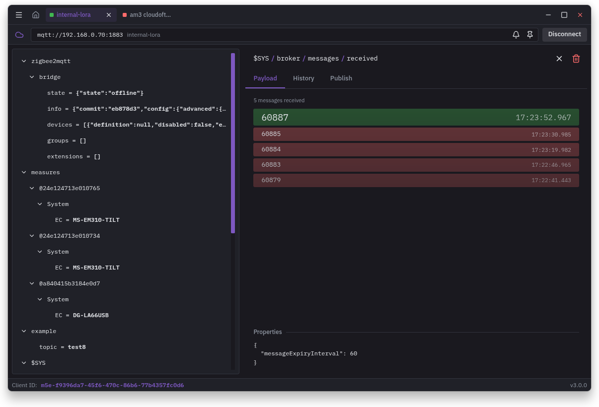
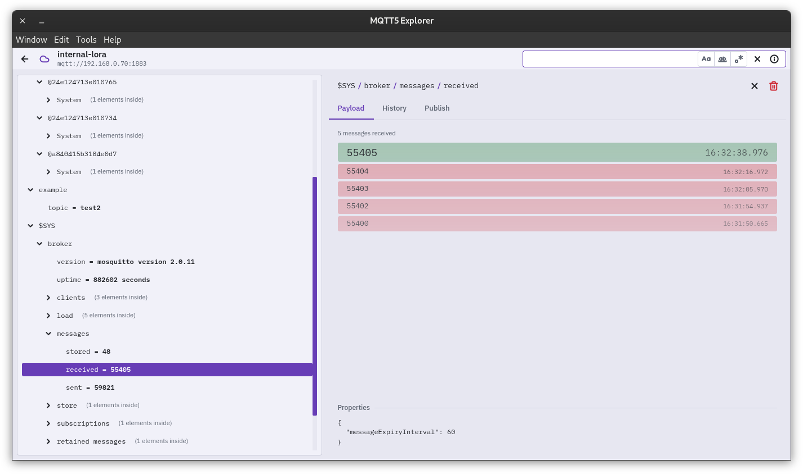

# MQTT5 Explorer

  

[](https://github.com/Omniaevo/mqtt5-explorer/issues) [](https://github.com/Omniaevo/mqtt5-explorer/actions)  [](https://github.com/Omniaevo/mqtt5-explorer/releases)  [](https://github.com/Omniaevo/mqtt5-explorer/blob/master/LICENSE) 

## About this project

The aim of this project is to bring the users a client app capable of making use of all the features of the version 5 of the MQTT protocol. The lack of any application that can offer the compatibility with the newer version of the protocol forced us to implement one to test the data of MQTT brokers workwise, why not to share this tool with others that may have the same issue?

[MQTT5 Explorer is live on **Netlify**!](https://mqtt5explorer.netlify.app/)

## Features

- **Browser-like window.** A tab strip replaces the native title bar. Windows and Linux keep the native window buttons. macOS keeps its traffic lights and menu bar.
- **Parallel connections.** Each connection opens in its own tab. Several brokers stay live at the same time. A tab shows the connection state and the number of new messages it got in the background.
- **Pinned tabs.** Pin a saved connection from the tab menu or the Home menu. Pinned tabs come back at the next start. They connect only when you select them.
- **Start page.** The Home tab has a search field, your recent connections as tiles (1 to 4 rows, set in Settings) and all other connections in a list.
- **Quick connect.** Type a broker URL (`mqtt://`, `mqtts://`, `ws://` or `wss://`) in the Home search and press Enter. It opens a temporary tab. Save the connection to pin it.
- **Topic search across tabs.** The Home search also finds topics in the connected tabs. A click opens the tab on that topic.
- **Wallpapers.** Pick one of 9 patterns for the Home page in Settings. They follow the theme and your primary color.
- **Settings tab.** Theme, font size, primary color, Home layout, connection defaults and the shortcut list.

### Keyboard shortcuts

Use `Cmd` instead of `Ctrl` on macOS.

| Action | Shortcut |
| --- | --- |
| Open settings | `Ctrl + ,` |
| Toggle search (connection tab) | `Ctrl + F` |
| Notifications and logging (connection tab) | `Ctrl + Shift + N` |
| Reload the tab | `Ctrl + R` |
| Force reload the tab | `Ctrl + Shift + R` |
| Close the tab | `Ctrl + W` |
| Close the window (macOS only) | `Cmd + Shift + W` |
| Focus the Home search (Home tab) | `Ctrl + L` or `/` |
| Next tab | `Ctrl + Tab` |
| Previous tab | `Ctrl + Shift + Tab` |
| Quit the app | `Ctrl + Q` |
| Show shortcuts | `Ctrl + K` |
| About the app | `Ctrl + I` |

## Screenshots

### Dark theme



### Light theme



## Downloads

<p>
  <a href='https://flathub.org/apps/io.github.Omniaevo.mqtt5-explorer'>
    
  </a>
</p>

<p>
  <a href="https://aur.archlinux.org/packages/mqtt5-explorer-bin">
    
  </a>
</p>

<p>
  <a href='https://github.com/Omniaevo/mqtt5-explorer/releases'>
    
  </a>
</p>

## Project setup

The app uses [Electron](https://www.electronjs.org/), [Vue 3](https://vuejs.org/), [Reka UI](https://reka-ui.com/), [Pinia](https://pinia.vuejs.org/) and [electron-vite](https://electron-vite.org/). You need [Node.js](https://nodejs.org/) 20 or newer.

```bash
npm install
```

Source layout:

- `src/main`: main process (window, tab manager, one MQTT session per connection tab, settings, logger, notifications).
- `src/preload`: preload script. It exposes `window.api` to the renderer.
- `src/renderer`: Vue 3 interface. It has no access to Node.js. One bundle with several routes: the shell (tab strip), Home, Settings and the connection viewer. Each tab is a separate view.
- `src/shared`: code used by both main and renderer.

### Compiles and hot-reloads for development

```bash
npm run dev
```

### Generate app icons

```bash
npm run electron:icons
```

### Lint and format

```bash
npm run lint             # ESLint (flat config) + Prettier rules
npm run lint -- --fix    # Fix what can be fixed automatically
npm run format           # Prettier write
```

### Unit tests

[Vitest](https://vitest.dev/) tests live next to the code as `*.test.js`.

```bash
npm test             # Run once
npm run test:watch   # Watch mode
```

## Compiles and minifies for production

`electron-vite` builds the app into `out/`. `electron-builder` packages it into `dist_electron/`.

```bash
# Build only (no package)
npm run build
# Preview the built app
npm run preview
```

**N.B.**: the package scripts use **electron publish** when you pass `-p always`. In this case, a _.env_ file with the `GITHUB_TOKEN` environment variable set is required.

```bash
# Linux
npm run build:linux # Without publish
npm run build:linux -- -p always # With GitHub publish

# MacOS
npm run build:mac # Without publish
npm run build:mac -- -p always # With GitHub publish

# Windows
npm run build:win # Without publish
npm run build:win -- -p always # With GitHub publish

# Flatpak
# ⚠️ The flatpak and flatpak-builder packages need to be installed in order to build Flatpak bundles. ⚠️
npm run build:linux -- flatpak
# Install and run the flatpak package
flatpak install --user mqtt5-explorer-[VERSION]-linux-x86_64.flatpak && flatpak run com.omniaevo.mqtt5_explorer
```

## Customize configuration

Configuration files:

- `electron.vite.config.mjs`: build of the main, preload and renderer bundles.
- `electron-builder.yml`: packaging (AppImage, Flatpak, dmg, portable exe), output dir and publish target.
- `vitest.config.mjs`, `eslint.config.mjs`, `.prettierrc`: tests, lint and format.
- `src/renderer/src/assets/css/tokens.css`: design tokens (colors, spacing, typography) for light and dark themes.
- `src/renderer/src/assets/css/wallpapers.css`: Home wallpaper patterns (tinted from the tokens).
- `src/renderer/src/components/ui/`: shared UI components built on Reka UI.
- `design/`: design system ("Reka Industrial"), tokens and a static sample page.

See:

- [electron-vite Configuration Reference](https://electron-vite.org/config/).
- [Vite Configuration Reference](https://vite.dev/config/).
- [Reka UI Documentation](https://reka-ui.com/docs/overview/getting-started).
- [Electron Build Configuration Reference](https://www.electron.build/docs/configuration).

## Get involved

See:

- [The code of conduct](CODE_OF_CONDUCT.md).
- [The contribution guidelines](.github/contributing.md).

## Contributors

[](https://github.com/Omniaevo/mqtt5-explorer/graphs/contributors)

## License

Copyright (C) 2021 Omniaevo SRL and contributors

This program is free software: you can redistribute it and/or modify it under the terms of the GNU General Public License version 3 only, as published by the Free Software Foundation. See [LICENSE](LICENSE).
